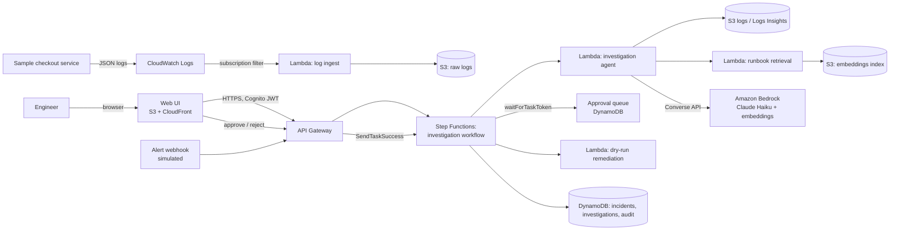

# Architecture and Implementation Plan

This document describes the target architecture for the Incident Management Copilot, the design decisions behind it, and the plan to build it end to end. It is written so each phase can be implemented, tested and demoed on its own.

## 1. Goals and non-goals

**Goals**

- Given an alert, gather the relevant logs, retrieve matching runbooks, and produce a root-cause hypothesis with cited evidence and a remediation plan.
- Keep every state-changing action behind an explicit human approval, and record who approved what.
- Measure the result: root-cause accuracy, citation accuracy and time to first summary, against labeled incidents.
- Stay within a small monthly AWS budget (target under USD 80) with no always-on expensive resources.

**Non-goals**

- Real remediation against production systems. Remediation is dry-run only.
- Real customer or employer data. Everything runs on the synthetic sample service and public or self-written documents.
- Replacing an incident-management platform. This is a copilot that sits beside one.

## 2. System context



## 3. Components

### 3.1 Sample checkout service (exists)

`sample-app/app.py` emits structured JSON logs and supports injected faults: `db_pool_exhaustion`, `disk_full`, `bad_deploy`. For AWS, it runs as a single Lambda (or a small container on App Runner later) behind API Gateway, so there is no always-on compute.

### 3.2 Log ingestion

- **CloudWatch Logs subscription filter** on the service's log group, forwarding to an ingest Lambda.
- The ingest Lambda normalises each event to a common schema (`ts, service, level, msg, status, route, incident_window_id`) and writes JSON Lines to `s3://<bucket>/logs/dt=YYYY-MM-DD/`.
- S3 lifecycle rule expires raw logs after 7 days to control storage cost.
- Why not Kinesis Firehose: it adds a minimum-charge pipeline that is hard to justify at demo volume.

### 3.3 Alerts

- A simulated alert webhook (`POST /alerts`) accepts alerts in a PagerDuty-like shape: `alert_id, title, service, severity, started_at, window`.
- Alerts are stored in DynamoDB and start a Step Functions execution.
- For the evaluation, the labeled incidents are replayed through the same endpoint.

### 3.4 Runbook knowledge base (RAG)

- **Corpus:** markdown runbooks and postmortems in `knowledge/`, one file per failure mode. Each has front matter with `runbook_id` and `failure_modes`.
- **Chunking:** split by heading, keep the heading path and `runbook_id` on every chunk so citations are exact.
- **Embeddings:** Amazon Bedrock embedding model (Titan Text Embeddings V2). Verify model availability in the chosen region first.
- **Index:** a single JSON/NumPy file in S3 with chunk text, metadata and vectors. For tens of documents, brute-force cosine similarity in Lambda is fast and costs nothing extra. It's rebuilt by a build script when runbooks change.
- **Alternative:** S3 Vectors, once its pricing and region availability are confirmed for this account. We avoid OpenSearch Serverless because its minimum capacity cost would exceed the whole budget.

### 3.5 Investigation agent

The agent is a bounded tool-use loop written directly against the Bedrock Converse API. No agent framework is used, so every step is visible in code and logs.

**Tools exposed to the model**

| Tool | Purpose | Notes |
|---|---|---|
| `query_logs(window, filter)` | Fetch matching log lines for the incident window | Reads from S3 JSONL; capped at N lines |
| `search_runbooks(query, k)` | Retrieve top-k runbook chunks | Returns text plus `runbook_id` and heading path |
| `get_alert(alert_id)` | Read the alert details | Read-only |
| `propose_remediation(steps)` | Record proposed steps for human review | Writes to DynamoDB; does not execute anything |

**Loop limits:** maximum 6 tool iterations, maximum tokens per call, and a hard timeout. If the limit is reached, the agent returns "insufficient evidence" with what it found, rather than guessing.

**Output contract (JSON, validated before storage):**

```json
{
  "root_cause": {"label": "db_pool_exhaustion", "confidence": 0.8, "summary": "..."},
  "evidence": [{"log_ts": "...", "quote": "...", "source": "logs"}],
  "citations": [{"runbook_id": "rb-db-pool", "heading": "Symptoms", "chunk_id": "..."}],
  "remediation": [{"step": "...", "risk": "low|medium|high", "dry_run": true}],
  "insufficient_evidence": false
}
```

A citation that does not match a retrieved chunk is rejected by the validator, and that rejection is counted in the evaluation.

### 3.6 Orchestration and human approval

Step Functions Standard workflow:

1. **Fetch** alert and window.
2. **Investigate** via the agent Lambda.
3. **Validate** the output contract. On failure, mark the investigation `needs_review` and stop.
4. **Await approval:** write the pending task to DynamoDB with the task token, then `waitForTaskToken`. A timeout (for example 24 hours) moves it to `expired`.
5. **Act:** on approve, call the dry-run remediation Lambda, which writes an action record. On reject, close with the reason.
6. **Audit:** every transition writes an event to the audit table with the actor (Cognito user ID or `system`).

Standard workflows are used rather than Express, because approval waits can be long.

### 3.7 API and authentication

- **API Gateway (HTTP API):** `POST /alerts`, `GET /incidents`, `GET /incidents/{id}`, `POST /incidents/{id}/decision`.
- **Cognito user pool** (free tier at this scale) with one or two users. The decision endpoint takes the approver's identity from the JWT, so approvals are attributable.
- Deploy-time access is separate: GitHub Actions uses OIDC to assume a short-lived role. No long-lived access keys are stored in GitHub or on disk.

### 3.8 Web UI

- Static single-page app (React + Vite, or plain TypeScript) hosted in a private S3 bucket behind CloudFront with origin access control.
- Screens: incident list, incident detail (timeline, evidence with links to log lines, citations with runbook excerpts, proposed remediation), approve/reject with confirmation.
- No server-side rendering or extra runtime, so there is no compute cost.

### 3.9 Data model (DynamoDB, on-demand)

| Table | Key | Attributes |
|---|---|---|
| `incidents` | `incident_id` | alert, status, created_at, latest_investigation_id |
| `investigations` | `incident_id` + `investigation_id` | output JSON, model_id, input_tokens, output_tokens, latency_ms, status |
| `approvals` | `incident_id` | task_token, requested_at, decision, decided_by, decided_at, reason |
| `audit` | `pk` (incident) + `sk` (timestamp#seq) | event, actor, payload summary |

Storing token counts per investigation is what makes the cost dashboard and the per-incident cost figure possible.

### 3.10 Observability and cost control

- Structured JSON logs from every Lambda, retained 7 days.
- A CloudWatch dashboard: investigations per day, validation failures, p50/p95 latency, and token totals.
- AWS Budgets: monthly budget at USD 80 with alerts at 25/50/80% actual and 100% forecast. Initially created by `scripts/setup_budgets.sh`, then moved into IaC as `CfnBudget` so it's versioned with the rest of the stack.
- Model choice: Claude Haiku for the investigation loop; a larger model only if evaluation shows Haiku's accuracy is the bottleneck, and only for the final summary.

## 4. Infrastructure as code

- **Tool:** AWS CDK in Python. Chosen because the team's code is Python, and CDK keeps the Lambda code and its infrastructure in one repo.
- **Stacks:**
  - `BudgetStack`: the monthly budget and alerts.
  - `DataStack`: S3 buckets (logs, knowledge, UI), DynamoDB tables.
  - `ServiceStack`: the sample checkout Lambda, API Gateway, and the log subscription filter.
  - `CopilotStack`: ingest, retrieval, agent and dry-run Lambdas, the Step Functions state machine, the approval API routes.
  - `AuthStack`: Cognito user pool and app client.
  - `UiStack`: S3 site bucket and CloudFront distribution.
- **Teardown:** `cdk destroy --all` after each demo. Log groups and S3 buckets get explicit removal policies so teardown is clean.
- **Environments:** one `dev` stage only, to keep the cost surface small.

## 5. Security

- **Least privilege:** each Lambda has its own role. The agent can read logs and invoke only the specific Bedrock model it needs; it cannot write to logs or call anything else.
- **No public data:** S3 buckets block public access; UI is served only through CloudFront with OAC.
- **Encryption:** SSE-S3 by default; DynamoDB default encryption.
- **Prompt-injection hygiene:** log lines and runbook text are treated as untrusted data. They are passed to the model inside clearly delimited blocks, and the model cannot trigger actions directly. Only the approval gate can.
- **Secrets:** none stored. Model access and deploy access use IAM roles and OIDC.
- **Audit:** every decision and state transition is in the audit table.

## 6. Evaluation

**Dataset.** `sample-app/data/incidents.jsonl` (40 labeled incidents). Each has an alert, logs, a ground-truth root cause and a ground-truth summary.

**Known weakness and fix.** The current generator reuses the same error messages as the runbooks, so keyword matching alone would score highly. Before reporting results, we add:
- paraphrased and noisy variants of each log message,
- a held-out set of incidents with different wording and extra unrelated errors,
- a `ground_truth_runbook` field, so citation accuracy can be scored.

**Metrics**

- Top-1 root-cause accuracy (exact label match).
- Citation accuracy: share of citations that point to the ground-truth runbook and whose text supports the claim (checked by the validator for presence, and by a manual sample for support).
- Validation failure rate.
- Time to first summary, against a manual baseline timed by hand.
- Cost per investigation (from stored token counts).

**Baselines.** A keyword-only baseline (match log messages to runbook titles) so the value of the LLM and RAG is measured rather than assumed.

**Process.** `scripts/evaluate.py` runs every labeled incident through the deployed API, collects results, and writes `docs/results/<date>.md` with the metrics table and the failing cases.

## 7. Implementation plan

Each phase ends with a tagged release and a short results note. Exit criteria are checked before moving on.

### Phase 1: Foundation (done locally)

- Sample service with faults, labeled generator, budget script, README, roadmap.
- **Exit:** local smoke test passes; repo pushed. ✅

### Phase 2: Infrastructure skeleton and budget

- CDK app with `BudgetStack` and `DataStack`. Replace the budget script with `CfnBudget`.
- GitHub Actions workflow: `cdk synth` on pull requests, `cdk deploy` on `main`, using OIDC.
- **Exit:** a deploy from GitHub Actions creates the budget and tables; `cdk destroy` removes them cleanly.

### Phase 3: Sample service and log pipeline

- Deploy the sample checkout service behind API Gateway.
- Subscription filter, ingest Lambda, S3 JSONL with lifecycle rule.
- Fault-injection endpoint protected by IAM or a simple shared secret stored in SSM Parameter Store.
- **Exit:** injecting each fault produces normalised log objects in S3 within a minute.

### Phase 4: Runbook RAG

- Write runbooks and one postmortem per failure mode.
- Chunker and embedding build script; index file in S3.
- `search_runbooks` Lambda.
- **Exit:** for each of the three failure modes, a query built from its error message returns that failure's runbook as the top result, in at least 9 of 10 test queries.

### Phase 5: Investigation agent

- Converse-based tool loop with the four tools, output validator and loop limits.
- Token and latency metrics written per investigation.
- **Exit:** the agent returns valid output contracts for the 40 labeled incidents, with a validation failure rate under 10%.

### Phase 6: Workflow, approval and API

- Step Functions workflow with `waitForTaskToken`, dry-run remediation, audit table.
- Alert webhook and decision endpoint; Cognito auth.
- **Exit:** an alert travels end to end, waits for approval, and records the approver. Rejecting and timing out both close the incident correctly.

### Phase 7: UI

- Incident list, detail view, decision flow.
- **Exit:** a reviewer can approve an incident in the browser and see the audit entry.

### Phase 8: Evaluation and cost report

- Add the paraphrased and held-out variants and `ground_truth_runbook` labels.
- Run `scripts/evaluate.py` against the deployed stack. Compare with the keyword baseline and the manual timing.
- Record cost per investigation and total spend.
- **Exit:** `docs/results/` contains the metrics, the failure analysis, and the cost table.

### Phase 9: Demo and write-up

- Two-minute demo: inject a fault, watch the investigation, approve the remediation.
- Architecture diagram and results in the README.
- Tear down the stack and confirm spend has stopped.
- **Exit:** the repo has a tagged `v1.0.0` release, the README links to the demo and results, and the AWS account has no running resources.

## 8. Risks and mitigations

| Risk | Mitigation |
|---|---|
| Bedrock model access or the embedding model is not available in the chosen region | Check availability before Phase 4; fall back to another region with the same models. |
| Costs exceed budget | Haiku by default; token metering; budget alerts; short log retention; teardown after each demo. |
| The agent looks accurate only because the synthetic data is too easy | Paraphrased and held-out variants; keyword baseline comparison. |
| Hallucinated citations | The validator rejects any citation not in the retrieved chunks; rejections are counted. |
| Prompt injection through log content | Untrusted-data delimiting; no direct action path from the model; approval gate. |
| Approval waits stall the workflow | Standard workflow with a timeout that marks the investigation expired. |
| Credits expire before the work is done | Check the expiry date first; do the expensive evaluation run last. |

## 9. Decisions still open

1. **AWS deploy path:** GitHub Actions with OIDC (recommended) or a one-off deploy from CloudShell.
2. **Region:** `ap-south-1` if the Claude and embedding models are available there; otherwise `us-east-1`.
3. **Runbook corpus:** written by hand from the sample service, which is the plan here, or reuse of public SRE runbook examples under a compatible license.
4. **Budget ceiling:** USD 80 as the default.
